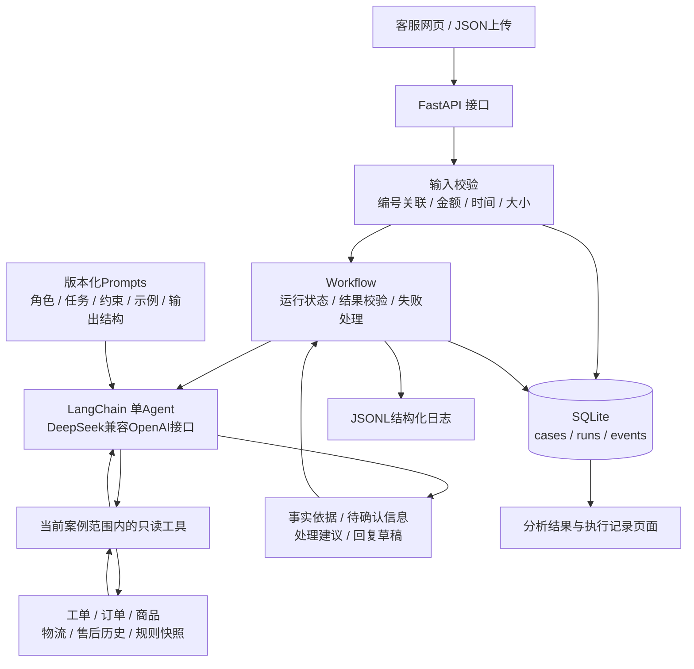
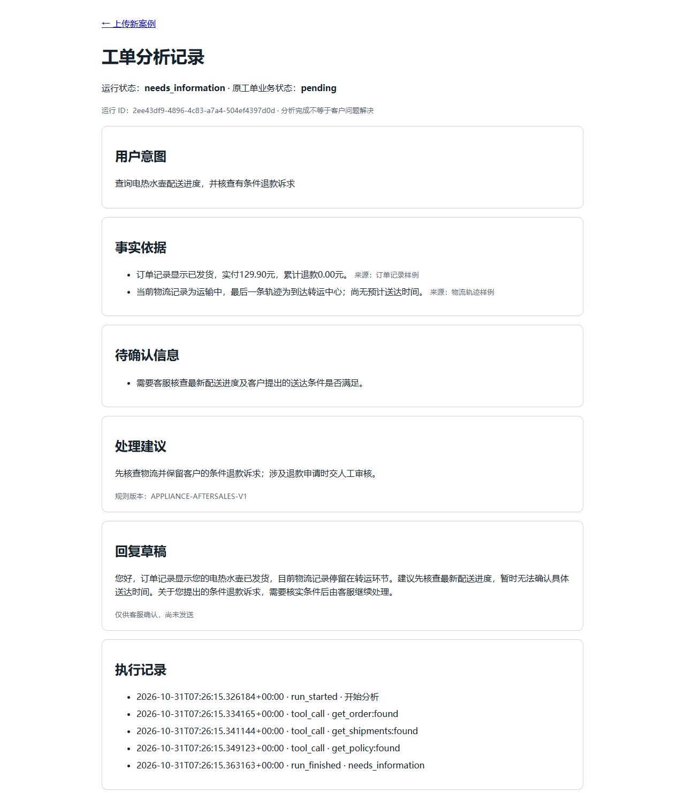

# 家电售后工单 Agent

**面向运营客服的家用电器售后分析助手：从客户问题出发，查询订单与业务资料，输出有来源的事实、处理建议和回复草稿。**


[快速开始](#快速开始) · [系统架构](#系统架构) · [核心功能](#核心功能) · [测试与评估](#测试与评估) · [已知限制](#已知限制)

## 项目背景

家电售后常见问题包括配送延迟、未发货、外观损坏、使用异常、配件缺失及退款进度。客服处理一张工单时，需要在客户描述、订单、商品、物流、退款历史与处理规则之间反复核对，才能给出有依据的答复。

本项目将这套核查过程组织为可追踪的工作流：**接收工单 → 校验业务关联 → Agent按需查询 → 校验输出 → 保存分析与执行记录**。目标是减少人工整理资料与撰写初稿的重复工作，让客服集中处理需要判断和复核的事项。

项目采用单Agent与明确工作流分工，保留每次分析的独立运行记录。仓库提供可复现的家电案例，便于验证接口、工具调用、异常处理和模型表现。

## 系统架构



### 一张工单如何流转

1. **校验入库**：接收UTF-8 JSON，检查工单与客户、店铺、订单、商品之间的关联，金额采用整数分。
2. **Agent判断**：从工单编号等必要上下文开始，决定需要核查哪些资料。
3. **只读工具查询**：调用对应工具取得业务快照、查询状态和来源，限制在当前案例范围内。
4. **生成与校验**：形成结构化分析，核对字段、实际查询过的来源和规则版本，检查受限动作表述。
5. **SQLite落库**：保存结果、状态和执行事件；客服可通过运行链接再次查看。

运行状态：`queued → running → succeeded / needs_information / failed`；服务重启时，未完成的运行标记为`interrupted`。分析状态与原工单业务状态独立维护。

## 技术栈

| 层次 | 技术 | 职责 |
|---|---|---|
| 语言 | Python ≥ 3.11，开发验证使用3.12 | 业务逻辑、工具与评估 |
| Web服务 | FastAPI 0.128.2、Uvicorn 0.40.0 | 上传、结果查询、健康检查 |
| Agent | langchain-core 1.2.9 | 消息编排与工具调用 |
| 模型接入 | langchain-openai 1.1.7、DeepSeek | 使用兼容OpenAI的接口调用模型 |
| 持久化 | SQLite、Python sqlite3 | 案例、运行、结果与事件 |
| 页面 | Jinja2 3.1.4、HTML/CSS | 上传入口与分析结果 |
| 观测 | logging、JSONL、日志轮转 | run_id关联事件、工具状态、耗时与成功调用用量 |
| 验证 | pytest 7.4.4、httpx 0.27.0 | 单元测试、接口测试与流程回归 |

依赖以[pyproject.toml](pyproject.toml)为准。

## 核心功能

| 功能 | 实现方式 |
|---|---|
| 工单导入 | 单文件上传，1 MiB上限；校验JSON结构、带时区时间和业务编号关联 |
| 按需查询 | `get_ticket`、`get_order`、`get_product`、`get_shipments`、`get_history`、`get_policy`六个工具 |
| 查询范围控制 | 工具核对请求编号，区分`found`、`not_found`与`forbidden` |
| 规则有效期 | 以案例快照时间筛选有效规则，记录所用规则版本 |
| 结构化输出 | 用户意图、事实依据、待确认信息、处理建议、回复草稿与分析状态 |
| 输出校验 | 检查必要字段、来源是否属于案例且经过实际查询，以及受限动作表述 |
| 运行控制 | 工具调用上限12次、90秒运行预算、单次模型请求超时30秒 |
| 结果留存 | 每次上传生成独立案例及运行ID，重复上传保留独立记录 |
| 异常追踪 | 保存失败类型及执行事件，重启后标记中断任务 |
| 结构化日志 | 按run_id关联流程和工具事件；单文件约2 MB轮转，保留5份备份 |

### 工程设计取舍

- **Workflow管流程，Agent管判断**：状态更新、持久化和失败处理由工作流负责，模型通过工具获取资料。
- **工具各负其责**：订单、商品、物流等查询分开实现，便于独立测试和替换数据来源。
- **提示词分模块管理**：角色、任务、行为约束、示例与输出结构分别维护，修改后可定位回归原因。
- **先建立可复现闭环**：用JSON固定业务快照，用SQLite保存运行，优先验证数据与决策链路。
- **测试与评估分别报告**：代码正确性、输入有效性和模型业务表现采用不同验证方式。

## 运行截图

以下图片从本版本实际运行的网页截取。结果页使用固定参考输出经过真实工具查询、结果校验和SQLite保存生成，用于展示页面结构；截图不作为真实模型评测结果。

### 工单上传


### 分析结果



## 快速开始

需要Python 3.11以上版本和可用的DeepSeek API配置。建议使用虚拟环境。

### 1. 获取代码并安装

```bash
git clone https://github.com/Yyl-8069/cleaning-ticket-agent.git
cd cleaning-ticket-agent
python -m venv .venv
```

Windows PowerShell：

```powershell
.\.venv\Scripts\Activate.ps1
python -m pip install -e ".[dev]"
```

macOS / Linux：

```bash
source .venv/bin/activate
python -m pip install -e ".[dev]"
```

### 2. 配置模型

应用从**进程环境变量**读取配置，配置示例见[.env.example](.env.example)。当前版本需要在启动终端中设置变量；`.env`文件不会自动加载。

PowerShell可通过隐藏输入读取密钥，避免把密钥明文写进命令历史：

```powershell
$secureKey = Read-Host "DeepSeek API Key" -AsSecureString
$env:DEEPSEEK_API_KEY = [System.Net.NetworkCredential]::new("", $secureKey).Password
Remove-Variable secureKey
$env:DEEPSEEK_MODEL = "deepseek-flash"
```

macOS / Linux（Bash）：

```bash
read -rsp "DeepSeek API Key: " DEEPSEEK_API_KEY; echo
export DEEPSEEK_API_KEY
export DEEPSEEK_MODEL=deepseek-flash
```

`DEEPSEEK_MODEL`为可选配置，上述值是本版本代码默认值；请按账号实际可用模型填写。模型请求地址配置在`agents/ticket_agent.py`。密钥、运行数据库和日志由`.gitignore`排除。

### 3. 启动与使用

```bash
python -m uvicorn app.main:app --host 127.0.0.1 --port 8000
```

- 打开[工单页面](http://127.0.0.1:8000)，上传`data/case-001.json`等案例。
- v1.0结果页在分析期间需要手动刷新；分析完成后可保存运行链接。
- [接口文档](http://127.0.0.1:8000/docs)由FastAPI生成；[健康检查](http://127.0.0.1:8000/health)检查服务与数据库。
- 按`Ctrl+C`停止服务。数据写入`runtime/app.db`，日志写入`runtime/agent.jsonl`。

### 案例数据

| 文件 | 家电 | 待处理问题 |
|---|---|---|
| `case-001.json` | 电热水壶 | 物流停滞与有条件退款意向 |
| `case-002.json` | 滚筒洗衣机 | 已付款未发货 |
| `case-003.json` | 双门冰箱 | 外观凹陷与退款诉求 |
| `case-004.json` | 电饭煲 | 渗水异常 |
| `case-005.json` | 无线吸尘器 | 缺少地刷 |
| `case-006.json` | 微波炉 | 已有退款记录查询 |

这些文件用于复现不同输入场景，包含工单消息、订单、商品、物流、售后历史及规则快照；输入要求`metadata.synthetic=true`。资料为项目构造的数据样例，不包含真实客户隐私，不代表品牌政策。每条场景的业务输出需要单独评估，文件可导入不等于已经通过模型验收。

## 测试与评估

### 代码测试

```bash
python -m pytest tests -q
```

覆盖输入与关联校验、文件大小限制、查询范围、来源约束、规则过期、工具调用、运行状态、失败日志脱敏、上传和结果查询。

### 固定输入校验

```bash
python -m evals.run_evals
```

当前固定评估集由基础案例派生5种条件：常规物流咨询、缺订单、缺规则、缺物流记录、提示词注入。默认命令只验证输入有效性。

### 真实模型评估

```bash
python -m evals.run_evals --live
```

配置API后运行，会产生模型调用费用。评估器检查期望词项与禁止表述，输出初筛结果、耗时和可获取的token用量；还需人工复核事实、工具选择、条件理解和答复质量。模型或提示词变更后，应以相同案例与配置重新评估。

**本次v1.0家电背景更新验证（2026-10-31）：** 27项代码测试通过，5项固定评估输入通过校验；本次未运行真实模型评估。两项数字分别表示代码检查和输入检查，均不表示模型业务准确率。六份公开案例与五项开发评估目前存在派生关系，后续需独立留出集衡量泛化表现。

## 项目结构

```text
├── app/             # FastAPI、页面、SQLite、结构化日志
├── agents/          # LangChain工具调用循环与模型结果校验
├── workflows/       # 分析流程、状态转换和失败处理
├── tools/           # 当前案例范围内的六类只读查询
├── context/         # 工单输入契约与关联校验
├── prompts/         # system / task / constraints / examples / schema
├── data/            # 六份家电业务案例
├── tests/           # 单元、接口与流程测试
├── evals/           # 固定条件、评分器与真实模型评估入口
├── skills/          # 项目技能目录说明
├── memory/          # 记忆策略说明
├── docs/            # 设计说明与运行截图
├── .env.example     # 环境变量占位示例
└── pyproject.toml   # 依赖、安装和测试配置
```

## 已知限制

- **执行方式**：后台任务运行在Web进程中；中断任务需要重新提交。当前界面采用手动刷新。
- **并发与访问**：当前适合本机单实例使用；账号认证、多租户授权、持久任务队列与并发压测仍待完善。
- **证据校验**：v1.0检查来源关联与部分受限表述，逐句事实、退款状态语义和复杂多诉求仍需人工复核。
- **资料能力**：规则随案例保存为快照，独立PDF解析、检索与页码引用列入后续迭代；附件图像分析尚待实现。
- **质量衡量**：现有小规模词项初筛不能覆盖完整业务语义；失败调用的用量与费用统计尚不完整。
- **运行预算**：90秒是调用前后的预算检查，受同步SDK调用影响，不是强制终止进程的硬截止。

## 开发与贡献

欢迎通过Issue提供脱敏复现输入、实际结果与期望行为。修改代码时同步补充对应测试；修改工具或提示词时记录版本并安排模型评估。

提交前执行测试及`git diff --check`，检查暂存区，避免包含`.env`、`runtime/`、日志或客户资料。项目约定见[AGENTS.md](AGENTS.md)，设计说明见[架构与版本记录](docs/实施计划.md)。
